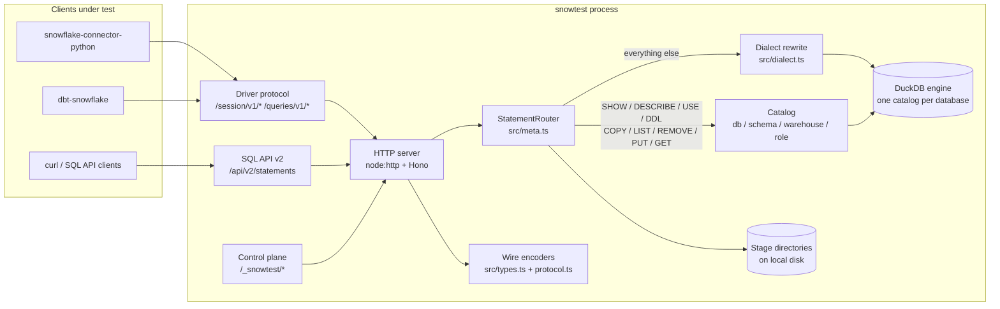
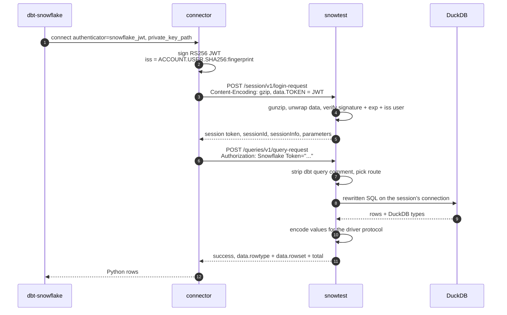
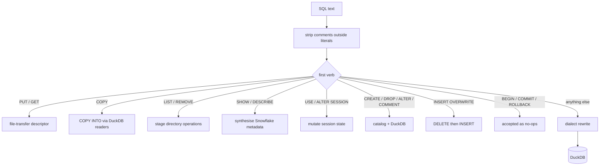
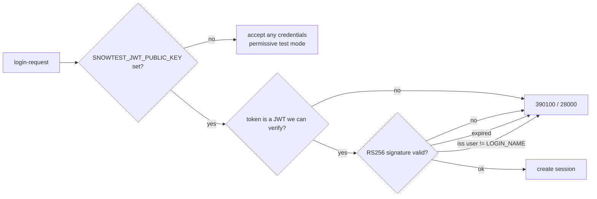
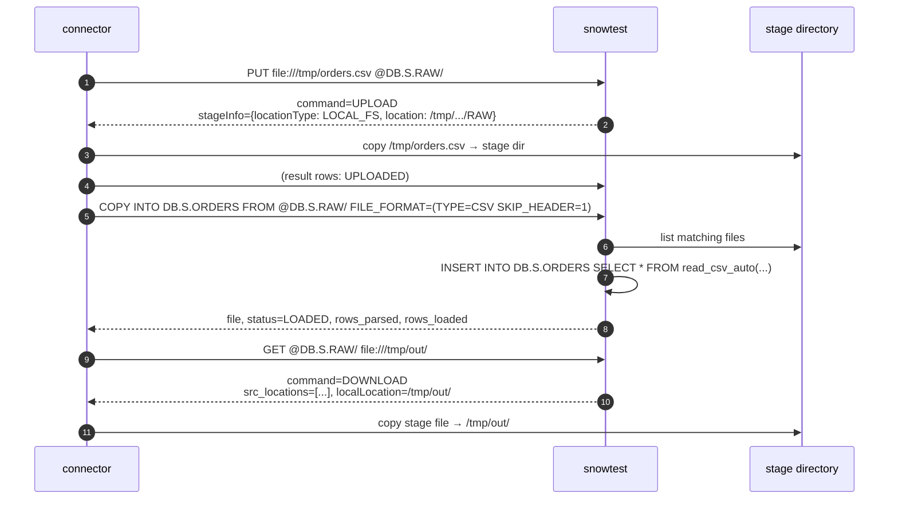
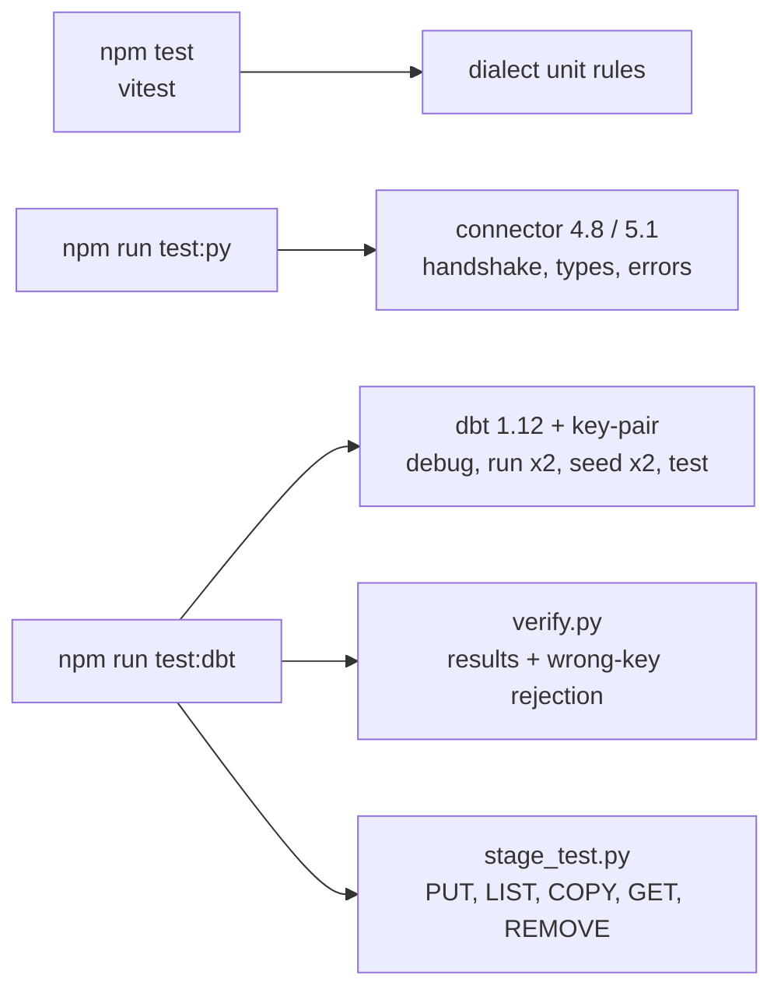

<!-- Copyright (c) 2026 Srinivas Chaturvedula -->

# snowtest — Design

A Snowflake-compatible stub server for testing systems that expect a real
Snowflake account. This document explains **what was built, why it is shaped
this way, and where the sharp edges are**. For commands, see
[usage.md](./usage.md).

- **Status:** working, verified against `snowflake-connector-python` 4.8 and
  5.1, `dbt-core` 1.12 / `dbt-snowflake` 1.12 over key-pair auth.
- **Not** a Snowflake replacement: no warehouses, no privileges, no cloud
  storage, no multi-node behaviour.

---

## 1. Problem

External systems do not speak one protocol. A testing stub has to satisfy
whichever wire contract the client under test uses, and each has a different
cost:

| Surface | Consumer | Why it matters |
|---|---|---|
| SQL REST API v2 | curl, HTTP integrations, custom services | documented, cheap to implement |
| Driver protocol (undocumented) | `snowflake-connector-python`, `dbt-snowflake`, Snowpark, JDBC-style clients | the one that matters: point dbt at `localhost` and it believes it is talking to Snowflake |
| ODBC | Power BI, Excel, Tableau | native C driver, own encoding — out of scope |

A stub that only *pattern-matches* SQL is useless the moment a test writes real
SQL. So the design goal was: **accept the real handshake, then actually execute
the statements.**

---

## 2. Architecture



Three surfaces over one statement router. Both result formats are built from the
same `Outcome`, so the driver protocol and the SQL API can never disagree about a
query's shape — they only disagree about *how a value is spelled*, which is
handled in one place (`src/types.ts`).

### Layout

```
src/server.ts    HTTP routes, gzip decoding, request/response plumbing
src/meta.ts      statement router: metadata/side-effecting SQL vs DuckDB
src/dialect.ts   Snowflake → DuckDB translation
src/engine.ts    DuckDB instance, per-session connections, catalog introspection
src/types.ts     type mapping + per-surface row encoding
src/protocol.ts  response envelopes (driver vs SQL API v2)
src/home.ts      landing page at / (connection details, live catalog state)
src/stage.ts     stage directories on disk (PUT/GET/LIST/COPY INTO backing)
src/catalog.ts   databases, schemas, warehouses, roles, stages
src/session.ts   per-connection session state and parameters
src/errors.ts    Snowflake-shaped errors (code + SQLSTATE + kind)
src/config.ts    flags and environment
src/cli.ts       entry point
```

---

## 3. Storage model

Each Snowflake **database** becomes its own DuckDB catalog:

```
Snowflake                 DuckDB
  SNOWTEST.PUBLIC.T  ──►  ATTACH ':memory:' AS "SNOWTEST"
                          "SNOWTEST"."PUBLIC"."T"
```

This is why no identifier rewriting is needed for three-part names, and why
`USE DATABASE` / `USE SCHEMA` can be per-session (`USE "DB"."SCHEMA"` on a
session's own connection) while the data is shared across all connections —
exactly Snowflake's split between account objects and session context.

**Single source of truth:** tables, views and columns are *not* mirrored in the
catalog. They are read back from `duckdb_tables()`, `duckdb_views()` and
`duckdb_columns()`. A table created by a test is therefore visible to
`SHOW TABLES` immediately, with no synchronisation step that can drift.

---

## 4. Request lifecycle



Two details in that diagram are load-bearing and were both discovered by running
a real client:

1. **Request bodies are gzipped.** Every connector call sets
   `Content-Encoding: gzip`. Without decoding at the HTTP boundary the login
   body parses as `{}`, the JWT is invisible, and the failure looks like an auth
   problem rather than a framing problem.
2. **Query comments must be stripped before routing.** dbt appends
   `/* {"app": "dbt", ...} */` to every statement. DuckDB ignores it; the
   metadata handlers match text with anchors, so `describe table x` became
   "unsupported statement".

---

## 5. Statement routing



Anything the router does not answer itself is handed to DuckDB. That is the
central design decision: **emulate the metadata, execute the SQL.**

Metadata answers are synthesised because DuckDB cannot answer them, and clients
(especially dbt) refuse to start without them:

- `SHOW TERSE SCHEMAS`, `SHOW TERSE OBJECTS IN SCHEMA`, `SHOW TABLES`,
  `SHOW WAREHOUSES`, `SHOW ROLES`, `SHOW STAGES`, `SHOW PARAMETERS`
- `SHOW USER FUNCTIONS` — empty set, but with the columns dbt selects
- `DESCRIBE TABLE`, `SHOW COLUMNS`
- `ALTER SESSION SET ...` — stored on the session, echoed by `SHOW PARAMETERS`

Field lists are not guesses: dbt's `list_relations_without_caching` selects
`database_name, schema_name, name, kind, is_dynamic, is_iceberg` and raises if
any is missing; `SHOW USER FUNCTIONS` needs `catalog_name`, `schema_name`,
`name`, `is_builtin`.

---

## 6. Auth

Two modes, both real:



- **Permissive (default).** Any credential is accepted; tokens are not checked.
  Keeps SQL-only tests trivial.
- **Verified.** With a PEM public key configured, key-pair logins are
  signature-checked (`RS256/384/512`), `exp` is enforced, and the `iss` claim's
  user must match the login name. Session tokens issued by snowtest are accepted
  for renewal without re-signing.

Key-pair is the service-account path and the one dbt uses: the client signs a
short-lived JWT with its private key; the server checks it against the public
key. Verifying it is what makes "does our key-pair setup work, and is a wrong key
refused?" a real assertion instead of a rubber stamp.

**There is no privilege model.** A verified token proves *identity*, not
authorisation — every session can read every table.

---

## 7. SQL translation

DuckDB already speaks a large subset of Snowflake, so the layer is deliberately
narrow and never guesses: anything untranslatable passes through and fails with
an honest Snowflake-shaped error rather than returning wrong data.

| Category | Examples |
|---|---|
| Session context | `CURRENT_DATABASE()`, `CURRENT_SCHEMA()`, `CURRENT_ROLE()`, `CURRENT_USER()`, `CURRENT_WAREHOUSE()`, `CURRENT_ACCOUNT()`, `CURRENT_VERSION()` |
| Functions | `IFF`, `NVL`, `NVL2`, `ZEROIFNULL`, `NULLIFZERO`, `DIV0`, `EQUAL_NULL`, `DECODE`, `SQUARE`, `GETDATE`, `SYSDATE` |
| Aggregates | `LISTAGG … WITHIN GROUP (ORDER BY …)`, `BOOL_OR/BOOL_AND` aliases |
| Dates | `DATEADD`, `DATEDIFF`, `TO_DATE`, `TO_TIMESTAMP*`, `TRY_TO_TIMESTAMP` |
| Casts | `TO_VARCHAR`, `TO_NUMBER`, `TO_BOOLEAN`, `::string`, `::number`, `::variant` |
| Semi-structured | `payload:path`, `payload:path::string`, `ARRAY_CONSTRUCT`, `OBJECT_CONSTRUCT`, `PARSE_JSON`, `TO_JSON` |
| Types | `NUMBER(p,s)`, `VARIANT`, `OBJECT`, `ARRAY`, `TIMESTAMP_NTZ/LTZ/TZ`, `BINARY`, `VARCHAR(16777216)` |
| DDL decoration | `TRANSIENT`, `CLUSTER BY`, `COPY GRANTS`, `DATA_RETENTION_TIME_IN_DAYS`, `CHANGE_TRACKING` |

Three rules exist because of concrete client failures, not tidiness:

1. **String literals and comments are masked** before rewriting, so
   `'IFF(a,b,c)'` inside a literal is never translated.
2. **Unquoted identifiers fold to upper case.** DuckDB is case-insensitive but
   case-*preserving*; Snowflake folds. dbt reads object names back from
   `SHOW TERSE OBJECTS` and matches them exactly, so a lower-case `stg_orders`
   in DuckDB against an upper-case `STG_ORDERS` lookup is only an "approximate
   match" — and dbt refuses to proceed.
3. **`MERGE … INSERT VALUES (col, …)` gets qualified with the source alias.**
   Snowflake resolves those against the source; DuckDB calls it ambiguous.

Bindings arrive as positional values from the connector (which rewrites `%s`
and `:name` to `?` client-side) and are inlined as SQL literals.

---

## 8. Result encoding

Snowflake's JSON result format is not JSON-native. Clients decode values using
`rowtype`, and several types are **strings that look like numbers**:

| Snowflake type | Wire value | Note |
|---|---|---|
| `fixed`, `real` | `"123"`, `"1.5"` | strings, to keep 38-digit precision |
| `boolean` | `"TRUE"` / `"FALSE"` | connector 4.x decodes with `value in ("1", "TRUE")`, so lower-case text silently becomes `False` |
| `date` | `"19737"` | epoch **days** |
| `time` | `"3600.000000000"` | fractional seconds since midnight |
| `timestamp_ntz` | `"1705314600.000000000"` | fractional epoch |
| `timestamp_ltz/tz` | `"1705314600.000000000 1440"` | epoch **plus display offset**; the connector splits on the space and fails the whole result set if the second part is missing |
| `variant` | JSON text | `json_extract_string` for `:field::string` so quotes are stripped |

The SQL API v2 uses a *different* encoder (human-readable formatted values), so
the two surfaces share the `Outcome` but not the spelling. Getting this wrong is
invisible in SQL and loud in Python — `assert rows[0][3] is True` returning
`False` is exactly how the boolean rule was found.

---

## 9. Stages and file transfer

`PUT`/`GET` are not ordinary queries. The SQL call returns a **descriptor**, then
the client moves the bytes itself. Snowflake hands out cloud credentials and
presigned URLs; emulating that is a lot of surface for no benefit.

Instead snowtest uses the connector's **`LOCAL_FS`** stage type — a supported
mode in which the client copies files straight to a directory the server names:



Consequences, stated plainly:

- **Client and server must share a filesystem.** `LOCAL_FS` writes the file on
  the *client's* machine at the path the *server* named. Same host or same
  container: fine. Different machines: `COPY INTO` will not find the file.
- **Uploads are flattened.** The local-FS client writes `basename(dst)`, so
  `@stage/data/x.csv` lands as `x.csv`. `LIST`, `COPY INTO`, `GET` and `REMOVE`
  therefore accept a directory-style prefix for a flat file.
- **No encryption, no presigned URLs.** Blobs are plain files.
- Each stage owns a directory under `SNOWTEST_STAGE_ROOT`; the default is a
  process-scoped temp directory, so a restart starts clean.

`COPY INTO` loads CSV, JSON and Parquet through DuckDB's readers. `COPY INTO
@stage FROM table` (unload) is not implemented.

---

## 10. dbt compatibility

Supported and verified: `dbt debug`, `dbt run` (view, table, incremental),
`dbt seed`, `dbt test`.

Non-obvious requirements, all discovered by running dbt rather than reading
about it:

| dbt does this | snowtest's answer |
|---|---|
| `SHOW TERSE SCHEMAS IN DATABASE` before anything else | synthesised from the catalog |
| `SHOW TERSE OBJECTS IN SCHEMA` for its relation cache | six required columns, including `is_dynamic` / `is_iceberg` |
| `SHOW USER FUNCTIONS IN SCHEMA` | empty set with `catalog_name` |
| `DESCRIBE TABLE …` | from `duckdb_columns()`, Snowflake type names |
| `CREATE OR REPLACE VIEW` on an existing view | replaced in place; the failure seen here was dbt's case-sensitive cache lookup, fixed by folding identifiers |
| `CREATE OR REPLACE TRANSIENT TABLE … AS` | `TRANSIENT` stripped |
| second `dbt run` → `MERGE … USING …` | insert values qualified with the source alias |
| `dbt seed` → `INSERT OVERWRITE INTO … VALUES (…)` | `DELETE` + `INSERT`, batched bindings inlined |
| a `/* {...} */` comment on every statement | stripped before routing |

`dbt seed` does **not** use `PUT`/`COPY INTO` — it inserts rows in batches with
`INSERT OVERWRITE`. Staged files matter for sources and manual loads.

---

## 11. Verification strategy

The only trustworthy oracle is the real client. Three suites, each pinning what
it depends on:



| Suite | Proves |
|---|---|
| `npm test` | translation rules in isolation |
| `npm run test:py` | login, DDL/DML, Python type fidelity, `DESCRIBE`, `SHOW`, variant access, binds, error codes, SQL API v2 async, isolation, reconnect |
| `npm run test:dbt` | a real transformation tool runs end to end over key-pair auth, including a second run (merge) and a second seed (overwrite must not duplicate) |

**Harness hazard worth recording:** the runners build and exec
`node dist/cli.js` directly. `npx tsx` spawns a child process, so killing the
wrapper leaves an orphaned server holding the port and serving *stale code*.
That produced two convincing but false failures during development.

---

## 12. Known limitations

- **Not a security boundary.** Permissive by default; even in verified mode
  there is no user, role or privilege model, and no TLS.
- In-memory engine: data lives for the process lifetime.
- Connector `execute_async` + `get_results_from_sfqid` is not implemented. The
  SQL API v2 async path (`?async=true`, then `GET /api/v2/statements/{handle}`)
  is, and is tested.
- No `COPY INTO @stage` (unload), no user (`@~`) or table (`@%table`) stages.
- No UDFs, stored procedures, tasks, streams, dynamic tables, replication,
  Snowpark, Snowpipe Streaming, `PUT`/`GET` encryption.
- Single result partition; JSON only (no Arrow).
- No ODBC.
- Warehouse "behaviour" is metadata: no queues, sizing or cost.

---

## 13. Extension points

- **New SQL function** → add a `replaceCall(...)` rule in `src/dialect.ts`; it is
  masked-aware and never fires inside literals.
- **New `SHOW` variant** → extend the regex and add a `case` in
  `StatementRouter.handleShow`, returning `syntheticOutcome(specs, rows)`.
- **New endpoint** → add a Hono route in `src/server.ts`; both metadata and
  results already flow through the router.
- **New wire type** → map it in `toSnowflakeType` and encode it in
  `driverValue` (`src/types.ts`) with the surface's spelling.
- **New stage capability** → `src/stage.ts` owns the filesystem; the SQL side is
  in `handlePut` / `handleGet` / `handleCopyInto`.
