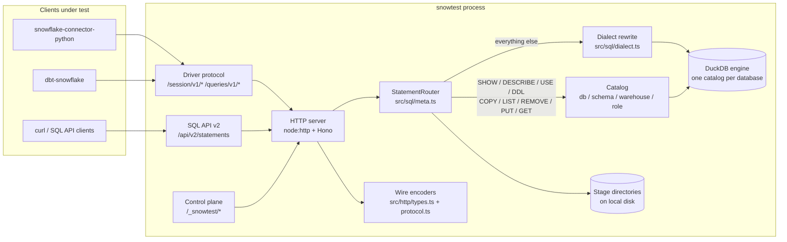
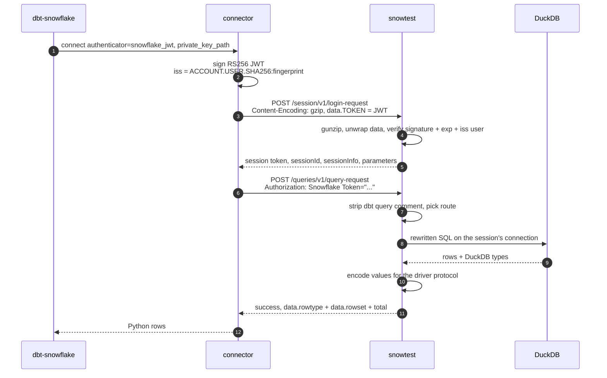
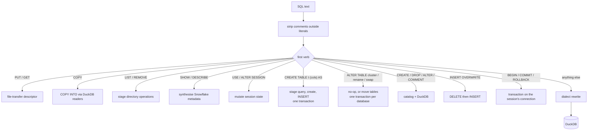
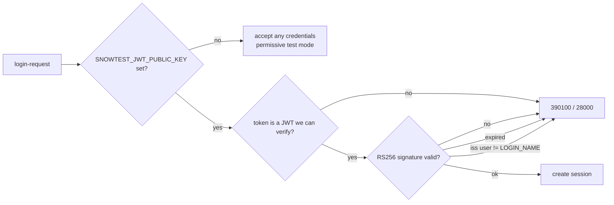
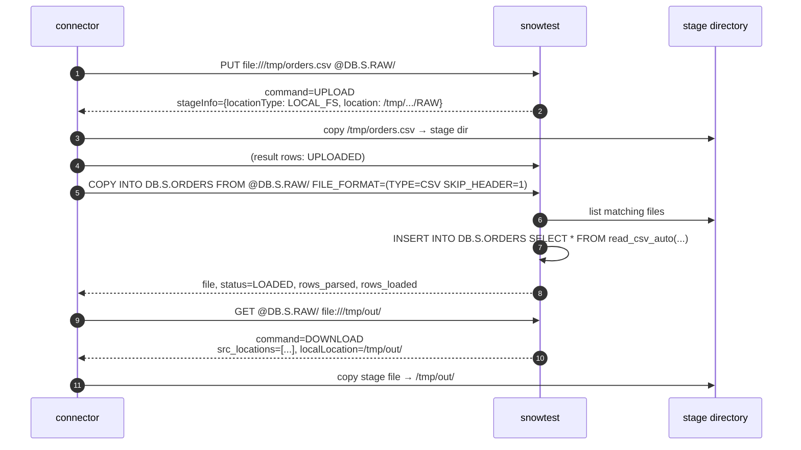
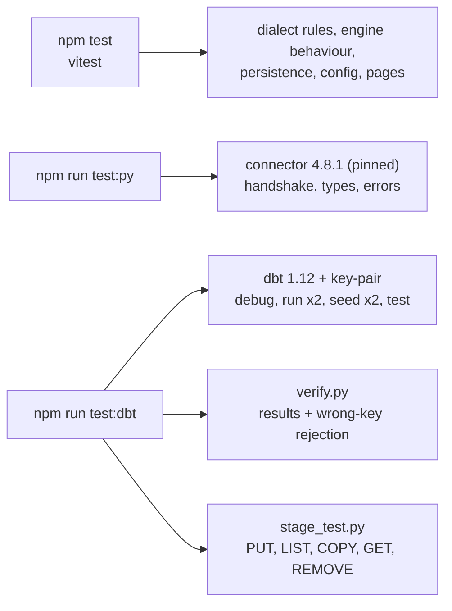

<!-- Copyright (c) 2026 Srinivas Chaturvedula -->

# snowtest — Design

A Snowflake-compatible stub server for testing systems that expect a real
Snowflake account. This document explains **what was built, why it is shaped
this way, and where the sharp edges are**. For commands, see the README and the
running server's `/configuration` page.

- **Status:** working; `snowflake-connector-python` 4.8.1 is what the Python
  suites run (`versions.json`); `dbt-snowflake` 1.12.5 and `dbt-core` 1.12.7 over key-pair
  auth.
- **Not** a Snowflake replacement: no warehouses, no privileges, no cloud
  storage, no multi-node behaviour.

---

## 1. Problem

External systems do not speak one protocol. A testing stub has to satisfy
whichever wire contract the client under test uses, and each has a different
cost:

| Surface | Consumer | Why it matters |
|---|---|---|
| SQL REST API v2 | curl, HTTP integrations, custom services | documented, cheap to implement |
| Driver protocol (undocumented) | `snowflake-connector-python`, `dbt-snowflake`, Snowpark, JDBC-style clients | the one that matters: point dbt at `localhost` and it believes it is talking to Snowflake |
| ODBC | Power BI, Excel, Tableau | native C driver, own encoding — out of scope |

A stub that only *pattern-matches* SQL is useless the moment a test writes real
SQL. So the design goal was: **accept the real handshake, then actually execute
the statements.**

---

## 2. Architecture



Three surfaces over one statement router. Both result formats are built from the
same `Outcome`, so the driver protocol and the SQL API can never disagree about a
query's shape — they only disagree about *how a value is spelled*, which is
handled in one place (`src/http/types.ts`).

### Layout

```
src/
  cli.ts           entry point (dist/cli.js)
  server.ts        HTTP routes, gzip decoding, request/response plumbing
  interceptor.ts   every statement passes through here: timing, QUERY_HISTORY, fidelity
  config/
    server-config.ts  defaults and environment resolution
    options.ts        flags and environment, shared by --help and /configuration
    fidelity.ts       the running fidelity mode: pinned by a flag, or saved by the control plane
    version.ts        snowtest current version, read from package.json
  engine/
    engine.ts      DuckDB instance, per-session connections, catalog introspection
    catalog.ts     databases, schemas, warehouses, roles, stages
    session.ts     per-connection session state and parameters
    persist.ts     SNOWTEST_DATA_DIR: one DuckDB file per database, stage definitions
  sql/
    meta.ts        statement router: metadata/side-effecting SQL vs DuckDB
    dialect.ts     Snowflake to DuckDB translation rules
    approximations.ts  every construct the fidelity pass reports, with its detail
    errors.ts      Snowflake-shaped errors (code + SQLSTATE + kind)
    stage.ts       stage directories on disk (PUT/GET/LIST/COPY INTO backing)
  http/
    protocol.ts    response envelopes (driver vs SQL API v2)
    types.ts       type mapping + per-surface row encoding
    selfcheck.ts   /self-test: checks run through the server HTTP surface
  pages/
    page.ts        shared HTML shell and stylesheet
    home.ts        landing page at / (connect, live catalog state, query timings, clear data)
    operations.ts  supported-operations reference at /operations, from data
    usage.ts       /configuration and /troubleshooting pages
    fidelity.ts    the Fidelity tab: what each mode does, and the control that applies one
    browse.ts      catalog browser at /browse
.snowtest/         per-instance stage directories created by setup.py
```

---

## 3. Storage model

Each Snowflake **database** becomes its own DuckDB catalog:

| Snowflake | DuckDB, in memory (default) | DuckDB, `SNOWTEST_DATA_DIR` set |
|---|---|---|
| database `SNOWTEST` | `ATTACH ':memory:' AS "SNOWTEST"` | `ATTACH '<dir>/SNOWTEST.duckdb' AS "SNOWTEST"` |
| `SNOWTEST.PUBLIC.T` | `"SNOWTEST"."PUBLIC"."T"` | same |
| stage definitions | catalog only | catalog + `<dir>/stages.json` |

With a data directory, startup reattaches every `*.duckdb` file, adds its
schemas to the catalog from `duckdb_schemas()`, and restores stages from
`stages.json`. `DROP DATABASE` deletes the file; `DROP DATABASE` / `DROP SCHEMA`
also remove the stages inside (definition, directory, `stages.json`), so every
persisted stage always has a schema to come back to; `/_snowtest/reset` deletes
all of them. Warehouses and roles are not persisted: they come from configuration.

Names are folded once, where SQL text or configuration enters (`normalizeName`);
the catalog, engine, stage store and file names use that canonical key as is, so
`"mydb"` stays `mydb` (`mydb.duckdb`) across a restart.

This is why no identifier rewriting is needed for three-part names, and why
`USE DATABASE` / `USE SCHEMA` can be per-session (`USE "DB"."SCHEMA"` on a
session's own connection) while the data is shared across all connections —
exactly Snowflake's split between account objects and session context.

**Single source of truth:** tables, views and columns are *not* mirrored in the
catalog. They are read back from `duckdb_tables()`, `duckdb_views()` and
`duckdb_columns()`. A table created by a test is therefore visible to
`SHOW TABLES` immediately, with no synchronisation step that can drift.

---

## 4. Request lifecycle



Two details in that diagram are load-bearing and were both discovered by running
a real client:

1. **Request bodies are gzipped.** Every connector call sets
   `Content-Encoding: gzip`. Without decoding at the HTTP boundary the login
   body parses as `{}`, the JWT is invisible, and the failure looks like an auth
   problem rather than a framing problem.
2. **Query comments must be stripped before routing.** dbt appends
   `/* {"app": "dbt", ...} */` to every statement. DuckDB ignores it; the
   metadata handlers match text with anchors, so `describe table x` became
   "unsupported statement".

---

## 5. Statement routing



Anything the router does not answer itself is handed to DuckDB. That is the
central design decision: **emulate the metadata, execute the SQL.**

Metadata answers are synthesised because DuckDB cannot answer them, and clients
(especially dbt) refuse to start without them:

- `SHOW TERSE SCHEMAS`, `SHOW TERSE OBJECTS IN SCHEMA`, `SHOW TABLES`,
  `SHOW WAREHOUSES`, `SHOW ROLES`, `SHOW STAGES`, `SHOW PARAMETERS`
- `SHOW USER FUNCTIONS` — empty set, but with the columns dbt selects
- `DESCRIBE TABLE`, `SHOW COLUMNS`
- `ALTER SESSION SET ...` — stored on the session, echoed by `SHOW PARAMETERS`

Field lists are not guesses: dbt's `list_relations_without_caching` selects
`database_name, schema_name, name, kind, is_dynamic, is_iceberg` and raises if
any is missing; `SHOW USER FUNCTIONS` needs `catalog_name`, `schema_name`,
`name`, `is_builtin`.

---

## 6. Auth

Two modes, both real:



- **Permissive (default).** Any credential is accepted; tokens are not checked.
  Keeps SQL-only tests trivial.
- **Verified.** With a PEM public key configured, key-pair logins are
  signature-checked (`RS256/384/512`), `exp` is enforced, and the `iss` claim's
  user must match the login name. Session tokens issued by snowtest are accepted
  for renewal without re-signing.

Key-pair is the service-account path and the one dbt uses: the client signs a
short-lived JWT with its private key; the server checks it against the public
key. Verifying it is what makes "does our key-pair setup work, and is a wrong key
refused?" a real assertion instead of a rubber stamp.

**There is no privilege model.** A verified token proves *identity*, not
authorisation — every session can read every table.

---

## 7. SQL translation

DuckDB already speaks a large subset of Snowflake, so the layer is deliberately
narrow and never guesses: anything untranslatable passes through and fails with
an honest Snowflake-shaped error, and syntax it recognises but cannot emulate
(an unknown format element, a number format model, an odd clock precision)
fails with `… is not supported on snowtest` (`002003`, SQLSTATE `0A000`).

| Category | Examples |
|---|---|
| Session context | `CURRENT_DATABASE()`, `CURRENT_SCHEMA()`, `CURRENT_ROLE()`, `CURRENT_USER()`, `CURRENT_WAREHOUSE()`, `CURRENT_ACCOUNT()`, `CURRENT_VERSION()`; NULL with no current database/schema |
| Clock | `CURRENT_TIMESTAMP[(p)]`, `LOCALTIMESTAMP[(p)]`, `CURRENT_TIME[(p)]`, `LOCALTIME`, `CURRENT_DATE()`, `SYSDATE()` (UTC, NTZ), `GETDATE()` |
| Functions | `IFF`, `NVL`, `NVL2`, `ZEROIFNULL`, `NULLIFZERO`, `DIV0`, `EQUAL_NULL`, `DECODE` (`IS NOT DISTINCT FROM`), `SQUARE` |
| Aggregates | `LISTAGG`/`ARRAY_AGG … WITHIN GROUP (ORDER BY …)` → ordering moved inside the call; `ARRAY_AGG` → `COALESCE(array_agg(x) FILTER (WHERE x IS NOT NULL), [])`; `BOOL_OR/BOOL_AND` aliases |
| Dates | `DATEADD`, `DATEDIFF`, `TO_DATE`, `TO_TIMESTAMP*` with format → `strptime` (`FF`/`FF9` → `%n`, `FF6` → `%f`, `FF3` → `%g`), `TO_TIMESTAMP(n, scale)` |
| Casts | `TO_VARCHAR` with format → `strftime`; `TO_NUMBER`, `TO_DOUBLE`, `TO_BOOLEAN`, `TO_BINARY`; every `TRY_` variant → `TRY_CAST`; `::string`, `::number`, `::variant` |
| Semi-structured | `payload:path`, `payload:path::string`, `ARRAY_CONSTRUCT`, `OBJECT_CONSTRUCT` (SQL-NULL pairs dropped, keys sorted), `PARSE_JSON` (malformed fails), `TRY_PARSE_JSON`, `TO_JSON` |
| Table functions | `LATERAL FLATTEN(input => …)` and `TABLE(FLATTEN(…))` → a lateral `json_each` join exposing `SEQ`, `KEY`, `PATH`, `INDEX`, `VALUE` and `THIS`; `path`, `outer` and `mode` are honoured, `recursive => TRUE` is refused |
| Types | `NUMBER[(p[,s])]`, `DECIMAL`/`NUMERIC` without scale → `DECIMAL(38,0)`, `VARIANT`, `OBJECT`, `ARRAY`, `STRING`, `FLOAT`, `TIMESTAMP_NTZ/LTZ/TZ`, `BINARY`, `VARCHAR(16777216)` — only in type positions: `::`, `CAST(… AS …)`, column definitions of `CREATE TABLE` and `ALTER TABLE … ADD | … TYPE` |
| String literals | Snowflake backslash escapes decoded (`\'`, `\\`, `\n`, `\t`, `\xhh`, `\uhhhh`, octal) and re-emitted as a DuckDB literal; NUL refused |
| DDL decoration | `TRANSIENT`, `CLUSTER BY`, `COPY GRANTS`, `DATA_RETENTION_TIME_IN_DAYS`, `CHANGE_TRACKING` |

Statements the router handles before translation (`src/sql/meta.ts`):

| Statement | Handling |
|---|---|
| `CREATE TABLE t (col type [NOT NULL] …) AS SELECT` | split by `splitColumnListCtas`: query into a temp table first (a self-reference reads the old rows), typed `CREATE` (PK/UNIQUE/FK dropped), then `INSERT` from the temp table, in one transaction |
| `BEGIN` / `COMMIT` / `ROLLBACK` | a real DuckDB transaction on the session's connection. A failed statement aborts it, and DuckDB has no `SAVEPOINT`, so the router's own internal transactions join an open client transaction instead of nesting |
| `CREATE TABLE … CLONE …` | copy the source's column definitions and rows; `AT`/`BEFORE` and `CREATE DATABASE | SCHEMA … CLONE` are refused |
| `a; b; c` | `splitStatements` runs each in turn; the driver protocol answers with the last outcome, the SQL API with one per statement |
| `ALTER TABLE t CLUSTER BY …` / `DROP CLUSTERING KEY` / `SUSPEND`/`RESUME RECLUSTER` | existence check, then a no-op |
| `ALTER TABLE t RENAME TO [db.][schema.]u` | DuckDB rename within a schema; across schemas, copy columns (type, NOT NULL) and rows, then drop, in one transaction; across databases (one written database per DuckDB transaction) commit a row-count-verified copy, then drop the source, removing the copy if that fails |
| `ALTER TABLE t SWAP WITH u` | three moves through a parked name, in one transaction; across databases refused (`not supported on snowtest`) |
| `DROP DATABASE` / `DROP SCHEMA` | missing object → `002003` unless `IF EXISTS`; schema `CASCADE` by default, `RESTRICT` honoured; stages inside removed; the session's current database/schema becomes NULL if dropped |
| `DESCRIBE STAGE` / `DESCRIBE FILE FORMAT` / `DESCRIBE SEQUENCE` | a stage or a format answers in Snowflake's five-column property table from the catalog; a sequence answers with the one row Snowflake returns for it, read from `duckdb_sequences()` |
| `SEQ.NEXTVAL` / `SEQ.CURRVAL` / `NEXT VALUE FOR SEQ` | → `nextval('DB.SCHEMA.SEQ')` / `currval(…)`, the name resolved from the session when it is not qualified. DuckDB keeps the counter, so a value is handed out even when the transaction rolls back, as in Snowflake; `CURRVAL` is per session |

Three rules exist because of concrete client failures, not tidiness:

1. **String literals, comments and quoted identifiers are masked** before
   rewriting, so `'IFF(a,b,c)'` inside a literal and a column named
   `"number"` or `"current_schema"` are never translated.
2. **Every unquoted identifier folds to upper case** — tables, columns,
   aliases (keywords and function names too, which DuckDB does not mind).
   DuckDB is case-insensitive but case-*preserving*, and reports names as
   stored; Snowflake folds. dbt matches relation names from `SHOW TERSE
   OBJECTS` exactly and reads column names from `DESCRIBE`, so a lower-case
   name is an "approximate match" dbt refuses. Quoted identifiers and variant
   path keys keep their case.
3. **`MERGE … INSERT VALUES (col, …)` gets qualified with the source alias.**
   Snowflake resolves those against the source; DuckDB calls it ambiguous.

Bindings arrive as positional values from the connector (which rewrites `%s`
and `:name` to `?` client-side) and are inlined as SQL literals.

---

## 8. Result encoding

Snowflake's JSON result format is not JSON-native. Clients decode values using
`rowtype`, and several types are **strings that look like numbers**:

| Snowflake type | Wire value | Note |
|---|---|---|
| `fixed`, `real` | `"123"`, `"1.5"` | strings, to keep 38-digit precision |
| `boolean` | `"TRUE"` / `"FALSE"` | connector 4.x decodes with `value in ("1", "TRUE")`, so lower-case text silently becomes `False` |
| `date` | `"19737"` | epoch **days** |
| `time` | `"3600.000000000"` | fractional seconds since midnight |
| `timestamp_ntz` | `"1705314600.000000000"` | fractional epoch |
| `timestamp_ltz/tz` | `"1705314600.000000000 1440"` | epoch **plus display offset**; the connector splits on the space and fails the whole result set if the second part is missing; always `1440` (UTC), as DuckDB's `TimeZone` is pinned to UTC |
| `variant` | JSON text | `json_extract_string` for `:field::string` so quotes are stripped |

The SQL API v2 uses a *different* encoder (human-readable formatted values,
except `time`, which keeps the spec's seconds form), so
the two surfaces share the `Outcome` but not the spelling. Getting this wrong is
invisible in SQL and loud in Python — `assert rows[0][3] is True` returning
`False` is exactly how the boolean rule was found.

---

## 9. Stages and file transfer

`PUT`/`GET` are not ordinary queries. The SQL call returns a **descriptor**, then
the client moves the bytes itself. Snowflake hands out cloud credentials and
presigned URLs; emulating that is a lot of surface for no benefit.

Instead snowtest uses the connector's **`LOCAL_FS`** stage type — a supported
mode in which the client copies files straight to a directory the server names:



Consequences, stated plainly:

- **Client and server must share a filesystem.** `LOCAL_FS` writes the file on
  the *client's* machine at the path the *server* named. Same host or same
  container: fine. Different machines: `COPY INTO` will not find the file.
- **Uploads are flattened.** The local-FS client writes `basename(dst)`, so
  `@stage/data/x.csv` lands as `x.csv`. `LIST`, `COPY INTO`, `GET` and `REMOVE`
  therefore accept a directory-style prefix for a flat file.
- **No encryption, no presigned URLs.** Blobs are plain files.
- Each stage owns a directory under `SNOWTEST_STAGE_ROOT`; the default is a
  process-scoped temp directory.
- Without `SNOWTEST_DATA_DIR`, stage definitions live only in the in-memory
  catalog, so a restart starts with no stages.
- With `SNOWTEST_DATA_DIR`, stage definitions (database, schema, name, URL) are
  restored from `stages.json` at startup and each gets its directory under
  `SNOWTEST_STAGE_ROOT` back. Files are not persisted by snowtest: a stage holds
  whatever that directory still contains (nothing, with the default temp root).

`COPY INTO` loads CSV, JSON and Parquet through DuckDB's readers. `COPY INTO
@stage FROM table` (unload) is not implemented.

---

## 10. dbt compatibility

Verified by `npm run test:dbt`, on the pair pinned in `versions.json`
(dbt-core 1.12.7, dbt-snowflake 1.12.5): `dbt debug`, `dbt run` (view, table,
incremental), `dbt seed` twice, `dbt test`, and the stage cycle.

Checked by hand on an earlier pin (dbt-core 1.12.6, dbt-snowflake 1.12.4), and
not part of the suite: `transient`, `copy_grants`, `cluster_by`,
`automatic_clustering`, incremental `delete+insert` and `append`, `contract:
enforced`, `dbt snapshot` (`timestamp` and `check`), `dbt source freshness`,
`dbt docs generate`, `dbt run-operation`.
Not supported: dynamic tables, materialized views, Python models, clone,
Iceberg. `grants:` runs, with the grants recorded and never enforced.

Non-obvious requirements, all discovered by running dbt rather than reading
about it:

| dbt does this | snowtest's answer |
|---|---|
| `SHOW TERSE SCHEMAS IN DATABASE` before anything else | synthesised from the catalog |
| `SHOW OBJECTS IN SCHEMA … LIMIT n` for its relation cache | six required columns, including `is_dynamic` / `is_iceberg` |
| `SHOW USER FUNCTIONS IN SCHEMA` | empty set with `catalog_name` |
| `DESCRIBE TABLE …` | from `duckdb_columns()`, Snowflake type names |
| `CREATE OR REPLACE VIEW` on an existing view | replaced in place; the failure seen here was dbt's case-sensitive cache lookup, fixed by folding identifiers |
| `CREATE OR REPLACE TRANSIENT TABLE … AS` | `TRANSIENT` stripped |
| `cluster_by` → `ALTER TABLE … CLUSTER BY (…)`, `RESUME RECLUSTER` | accepted as no-ops |
| `contract: enforced` → `CREATE TABLE t (cols) AS (SELECT …)` | typed create + insert; NOT NULL enforced |
| snapshots / freshness → `to_timestamp_ntz(convert_timezone('UTC', current_timestamp()))` | `CURRENT_TIMESTAMP()` call form translated |
| catalog → `to_varchar(…, 'yyyy-mm-dd HH24:MI'\|\|'UTC')` | literal concatenation folded; `UTC` copied through |
| `DESCRIBE TABLE` column names drive `MERGE` / snapshot column lists | upper case, NOT NULL reported |
| second `dbt run` → `MERGE … USING …` | insert values qualified with the source alias |
| `dbt seed` → `INSERT OVERWRITE INTO … VALUES (…)` | `DELETE` + `INSERT`, batched bindings inlined |
| a `/* {...} */` comment on every statement | stripped before routing |

`dbt seed` does **not** use `PUT`/`COPY INTO` — it inserts rows in batches with
`INSERT OVERWRITE`. Staged files matter for sources and manual loads.

---

## 11. Verification strategy

The only trustworthy oracle is the real client. Three suites; the Python suites
pin the connector named in `versions.json` (4.8.1):



| Suite | Proves |
|---|---|
| `npm test` | translation rules in isolation, plus each rule run against DuckDB through the SQL API (contracts, rename/swap, conversions, column case, restart persistence, reset) |
| `npm run test:py` | login, DDL/DML, Python type fidelity, `DESCRIBE`, `SHOW`, variant access, binds, error codes, SQL API v2 async, isolation, reconnect |
| `npm run test:dbt` | a real transformation tool runs end to end over key-pair auth, including a second run (merge) and a second seed (overwrite must not duplicate) |

**Harness hazard worth recording:** the runners build and exec
`node dist/cli.js` directly. `npx tsx` spawns a child process, so killing the
wrapper leaves an orphaned server holding the port and serving *stale code*.
That produced two convincing but false failures during development.

**Reuse by design:** both runners probe `/_snowtest/health` on their port first
and use whatever answers, so `SNOWTEST_TEST_PORT=3030 npm run test:py` exercises
the container itself — its data and its timings table are exactly the point of
pointing a suite there. `SERVER_PID` stays empty when a server was borrowed, and
the exit trap only stops a process the runner started.

---

## 12. Known limitations

- **Not a security boundary.** Permissive by default; even in verified mode
  there is no user, role or privilege model, and no TLS.
- In memory by default: data lives for the process lifetime unless
  `SNOWTEST_DATA_DIR` is set (`setup.py` and `compose.yaml` set it).
- Single result partition; JSON only (no Arrow).
- No replication: there is no second account or region to replicate to.

Everything a statement can hit, whether a refused statement, a partial type or a
gap in a function, is on the **Not supported** tab of `/operations`, which is
generated from `src/pages/operations.ts`. This list stops at the limits that have no
statement to hang on.

---

## 13. Extension points

- **New SQL function** → add a `replaceCall(...)` rule in `src/sql/dialect.ts`; it is
  masked-aware and never fires inside literals.
- **New `SHOW` variant** → extend the regex and add a `case` in
  `StatementRouter.handleShow`, returning `syntheticOutcome(specs, rows)`.
- **New endpoint** → add a Hono route in `src/server.ts`; both metadata and
  results already flow through the router.
- **New wire type** → map it in `toSnowflakeType` and encode it in
  `driverValue` (`src/http/types.ts`) with the surface's spelling.
- **New stage capability** → `src/sql/stage.ts` owns the filesystem; the SQL side is
  in `handlePut` / `handleGet` / `handleCopyInto`.
