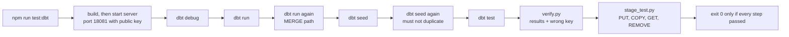

<!-- Copyright (c) 2026 Srinivas Chaturvedula -->

# snowtest — Usage

A Snowflake-compatible stub server for testing. Point a client's `host`/`port`
at it and it answers the way Snowflake does — no account, no warehouse cost, no
network.

Every command below is copy-pasteable. Design rationale lives in
[design.md](./design.md). Supported endpoints and metadata queries:
[§11](#11-what-snowtest-answers).

---

## 1. Run it as a container

Podman and Docker both work and take the same image; `setup.py` runs either,
preferring podman. It builds, starts, waits for health, and prints a profile you
can paste into a dbt project.

```bash
./setup.py up          # build if missing, run, wait for /_snowtest/health
./setup.py status      # container state plus the live health response
./setup.py logs -f     # follow the server log
./setup.py reset       # between test runs: drop everything, recreate the catalog
./setup.py redeploy    # after a code change: down, reset, rebuild, up
./setup.py down        # stop and remove the container
```

`up` finishes with the connection details, then the dbt profile (§3):

```
snowtest is up.  (health: ok)

  endpoint   http://127.0.0.1:3030  (http://snowtest:3030 on snowtest-network)
  account    SNOWTEST   database SNOWTEST   warehouse SNOWTEST_WH
  stages     /home/me/snowtest/.snowtest/stages  (bind-mounted at /home/me/snowtest/.snowtest/stages inside)
  auth       permissive: any user/password is accepted
```

### Ports and networks

| Started by | Listens on (in container) | From the host | From another container |
|---|---|---|---|
| `setup.py up` / `redeploy` | `3030` (sets `SNOWTEST_PORT=3030`) | `http://localhost:<--port>` (default `3030`) | `http://snowtest:3030` on `--network` (default `snowtest-network`, created if missing) |
| `compose.yaml` | `3030` | `http://localhost:3030` | `http://snowtest:3030` on `snowtest-network` |
| raw `podman run` / `docker run` | image default `8080`, unless `-e SNOWTEST_PORT=…` | as published with `-p` | only with `--network snowtest-network` |

The raw examples below pass `-e SNOWTEST_PORT=3030 -p 3030:3030` so every
command in this guide uses one port.

### Launcher flags

| Flag | Applies to | Default | Effect |
|---|---|---|---|
| `--port` | all | `3030` | host port published to container port 3030 |
| `--network` | all | `snowtest-network` | network to join; created if missing |
| `--engine` | all | `auto` | `podman` / `docker`; auto prefers podman |
| `--image` | all | `snowtest:1.0.0` | image tag |
| `--stage-root` | all | `<repo>/.snowtest/stages` | host stage directory |
| `--public-key` | all | unset | PEM public key; enables verified key-pair login |
| `--users` | all | unset | login allow-list (`SNOWTEST_USERS`) |
| `--env KEY=VALUE` | all | — | extra env var; repeatable |
| `--selinux` | all | `auto` | `auto` / `on` / `off` — `:Z` mount label |
| `--userns` | all | `auto` | `auto` / `keep-id` / `none` — podman uid mapping |
| `--timeout` | all | `60` | seconds to wait for `/_snowtest/health` |
| `--dry-run` | all | off | print commands, run nothing |
| `--recreate`, `--rebuild` | `up` | off | replace running container; rebuild image |
| `--write-profile DIR`, `--force` | `up`, `redeploy` | off | write / overwrite `DIR/profiles.yml` |
| `--no-cache` | `redeploy`, `build` | off | ignore build cache |
| `--keep-stages` | `redeploy` | off | keep staged files |
| `--[no-]seed-examples` | `up`, `redeploy` | on | load the bundled example tables (see below) |
| `-n/--tail`, `-f/--follow` | `logs` | `100`, off | log lines; follow |

Anything after `--` is appended to the server command line:

```bash
./setup.py up -- --verbose
```

### Redeploy after a change

`up` reuses a container that is already running and skips the build when the
image exists. That is what you want in a tight test loop, but not after editing
the source. `redeploy` does the whole cycle in one command:

```bash
./setup.py redeploy
```

1. stops and removes the `snowtest` container if one exists (no container is
   fine, it says so and carries on);
2. empties the stage directory — `--keep-stages` preserves staged files;
3. rebuilds the image (`--no-cache` to ignore the build cache);
4. starts a fresh container and waits for `/_snowtest/health`;
5. seeds the bundled example tables (`--no-seed-examples` skips it).

The catalog lives in memory, so the new container comes up empty: `redeploy` is
also the cleanest reset there is.

```bash
./setup.py redeploy --no-cache --public-key keys/rsa_key.pub --users DBT_SVC
```

### Example data

`up` and `redeploy` load a small sample retail dataset, so there is something to
query right away:

| | |
|---|---|
| Target | `SNOWTEST.EXAMPLES` |
| Tables | `STORES`, `PRODUCTS`, `CUSTOMERS`, `ORDERS`, `ORDER_ITEMS` (5 / 8 / 6 / 10 / 15 rows) |
| Source | [`data/examples.sql`](../data/examples.sql) — plain Snowflake SQL; edit it to change the sample |
| How | `POST /_snowtest/seed`; tables are `CREATE OR REPLACE`d, so reruns are safe |
| Off | `--no-seed-examples` |

`./setup.py reset` clears it; `./setup.py up` reloads it.

### Raw podman

```bash
podman build -t snowtest:1.0.0 .
podman network create snowtest-network   # once
podman run -d --name snowtest --network snowtest-network \
  -p 3030:3030 -e SNOWTEST_PORT=3030 \
  --userns=keep-id:uid=1000,gid=1000 \
  snowtest:1.0.0
```

`--userns=keep-id:uid=1000,gid=1000` maps the image's `node` user onto your own
UID, so the server can write staged files into a directory you own. Keep it
whenever a stage directory is bind-mounted.

### Raw docker

```bash
docker build -t snowtest:1.0.0 .
docker network create snowtest-network   # once
docker run -d --name snowtest --network snowtest-network \
  -p 3030:3030 -e SNOWTEST_PORT=3030 snowtest:1.0.0
```

### Compose, either engine

```bash
docker compose up -d && docker compose logs -f snowtest
podman compose up -d && podman compose logs -f snowtest
```

### Podman notes

- No daemon and no `docker` group, so it works where Docker is not allowed.
- The image is an ordinary `Dockerfile`; podman builds it unchanged.
- On SELinux hosts (Fedora, RHEL) bind mounts need the `:Z` label, otherwise the
  container sees `Permission denied`. `setup.py` adds it when
  `/sys/fs/selinux/enforce` is `1`; add it by hand in raw commands.
- `keep-id:uid=1000,gid=1000` needs podman 4.3+. Older builds reject the flag as
  unknown: upgrade, or pass `--userns none` and make the stage directory
  writable by the container user.

Check it is alive:

```bash
curl -s localhost:3030/_snowtest/health
# {"status":"ok","emulatedSnowflakeVersion":"8.42.0","snowtestVersion":"1.0.0"}
```

Flags pass straight through, because the entrypoint is `node dist/cli.js`, and
they are identical on both engines:

```bash
docker run --rm -p 9090:9090 -e SNOWTEST_PORT=9090 snowtest:1.0.0 --verbose
podman run --rm -p 9090:9090 -e SNOWTEST_PORT=9090 snowtest:1.0.0 --verbose
```

Prefer `SNOWTEST_PORT` over `--port` here: the image health check reads
`SNOWTEST_PORT`, so a `--port`-only change reports `unhealthy`.

Configuration is environment-based, so mount what it needs and set what you
want. Docker:

```bash
docker run --rm -p 3030:3030 -e SNOWTEST_PORT=3030 \
  -v "$PWD/keys:/keys:ro" \
  -e SNOWTEST_JWT_PUBLIC_KEY=/keys/rsa_key.pub \
  -e SNOWTEST_USERS=DBT_SVC \
  snowtest:1.0.0
```

Podman — note `:ro,Z` on the key and the keep-id mapping:

```bash
podman run -d --name snowtest --network snowtest-network \
  -p 3030:3030 -e SNOWTEST_PORT=3030 \
  --userns=keep-id:uid=1000,gid=1000 \
  -v "$PWD/keys/rsa_key.pub:/run/snowtest/public_key:ro,Z" \
  -e SNOWTEST_JWT_PUBLIC_KEY=/run/snowtest/public_key \
  -e SNOWTEST_USERS=DBT_SVC \
  snowtest:1.0.0
```

Or let the launcher do it: `./setup.py up --public-key keys/rsa_key.pub --users DBT_SVC`.

The image also declares a health check that hits `/_snowtest/health` with
Node's built-in `fetch`, so no curl is needed inside the container.

### From source, only if you are developing snowtest

Requires Node 20+:

```bash
npm install
npm run build
node dist/cli.js
# or, with reload: npm start
```

---

## 2. Connect

### Python connector, password

```python
import snowflake.connector

conn = snowflake.connector.connect(
    account="SNOWTEST",
    user="test_user",
    password="test_password",
    host="127.0.0.1",
    port=3030,
    protocol="http",          # plain HTTP; there is no TLS
    database="SNOWTEST",
    schema="PUBLIC",
    warehouse="SNOWTEST_WH",
)
cur = conn.cursor()
cur.execute("SELECT CURRENT_DATABASE(), CURRENT_SCHEMA(), CURRENT_USER()")
print(cur.fetchall())
```

### Python connector, key pair

```bash
openssl genrsa -out rsa_key.p8 2048
openssl rsa -in rsa_key.p8 -pubout -out rsa_key.pub
```

```python
conn = snowflake.connector.connect(
    account="SNOWTEST",
    user="DBT_SVC",
    authenticator="snowflake_jwt",
    private_key_file="rsa_key.p8",
    host="127.0.0.1", port=3030, protocol="http",
    database="SNOWTEST", schema="PUBLIC",
)
```

### Make key-pair auth actually verified

Register the public key (and optionally an allow-list) at start-up:

```bash
./setup.py up --recreate --public-key keys/rsa_key.pub --users DBT_SVC
```

| Configuration | Login behaviour |
|---|---|
| no `--public-key` (`SNOWTEST_JWT_PUBLIC_KEY` unset) | any password and **any JWT signature** accepted |
| `--public-key` set | JWT must be signed by the matching private key |
| `--users` set (`SNOWTEST_USERS`) | login name must be in the list |
| `--public-key` path unreadable | server refuses to start |

With a key registered:

| Situation | Result |
|---|---|
| token signed by the matching private key | accepted |
| token signed by any other key | `390100 (28000)` |
| expired token | `390100 (28000)` |
| `iss` user ≠ login name | `390100 (28000)` |

How to test the negative path:

```bash
openssl genrsa -out wrong_key.p8 2048   # never registered
```

```python
try:
    snowflake.connector.connect(
        account="SNOWTEST", user="DBT_SVC",
        authenticator="snowflake_jwt", private_key_file="wrong_key.p8",
        host="127.0.0.1", port=3030, protocol="http",
    )
    raise AssertionError("wrong key was accepted")
except snowflake.connector.errors.DatabaseError as error:
    assert "390100" in str(error)
```

---

## 3. dbt

`profiles.yml` — exactly what `./setup.py up --public-key … --write-profile DIR`
writes (without `--public-key` it writes `user: test` / `password: test`):

```yaml
snowtest:
  target: dev
  outputs:
    dev:
      type: snowflake
      account: SNOWTEST
      user: DBT_SVC
      authenticator: snowflake_jwt
      private_key_path: /absolute/path/to/rsa_key.p8
      database: SNOWTEST
      schema: PUBLIC
      warehouse: SNOWTEST_WH
      role: SYSADMIN
      threads: 4
      host: 127.0.0.1
      port: 3030
      protocol: http
```

Any schema works — dbt creates it. The bundled suite (`tests/dbt/profiles.yml`)
uses `schema: DBT_TEST` on port 18081.

```bash
dbt debug --profiles-dir /path/to/profiles-dir
dbt run   --profiles-dir /path/to/profiles-dir
dbt seed  --profiles-dir /path/to/profiles-dir
dbt test  --profiles-dir /path/to/profiles-dir
```

Start the server first — [§1](#1-run-it-as-a-container) covers the plain case;
with verified key-pair auth, and a stage directory `dbt seed` can write to, one
command:

```bash
./setup.py up --public-key keys/rsa_key.pub --users DBT_SVC
```

The raw podman equivalent:

```bash
podman build -t snowtest:1.0.0 .
podman run -d --name snowtest --network snowtest-network \
  -p 3030:3030 -e SNOWTEST_PORT=3030 \
  --userns=keep-id:uid=1000,gid=1000 \
  -v "$PWD/keys/rsa_key.pub:/run/snowtest/public_key:ro,Z" \
  -e SNOWTEST_JWT_PUBLIC_KEY=/run/snowtest/public_key \
  -e SNOWTEST_USERS=DBT_SVC \
  snowtest:1.0.0
```

If dbt runs in another container on `snowtest-network`, use `host: snowtest`
and `port: 3030` in the profile instead of `127.0.0.1`.

Verified against `dbt-core` 1.12 and `dbt-snowflake` 1.12: `debug`, `run`
(view / table / incremental), `seed`, `test`.

---

## 4. Staged files

`PUT` / `GET` use the connector's local-filesystem stage mode, so the client
copies bytes straight into a directory the server owns. **Client and server must
see the same absolute path.** With snowtest in a container that means one of:

- run the client in the same container as snowtest;
- mount one volume into both containers **at the same path** and point
  `SNOWTEST_STAGE_ROOT` at it;
- share a network namespace and a volume with `--network container:snowtest`.

```bash
docker volume create snowtest-stages

docker run -d --name snowtest -p 3030:3030 -e SNOWTEST_PORT=3030 \
  -v snowtest-stages:/var/lib/snowtest/stages \
  -e SNOWTEST_STAGE_ROOT=/var/lib/snowtest/stages \
  snowtest:1.0.0

# a client container: same volume, same path, snowtest's network namespace
docker run --rm --network container:snowtest \
  -v snowtest-stages:/var/lib/snowtest/stages \
  -v "$PWD:/work" -w /work \
  your-dbt-image dbt seed --profiles-dir .
```

If the client stays on the host, bind-mount the *same host path* into the
container so both sides agree:

```bash
docker run -d --name snowtest -p 3030:3030 -e SNOWTEST_PORT=3030 \
  -v /srv/stages:/srv/stages \
  -e SNOWTEST_STAGE_ROOT=/srv/stages \
  snowtest:1.0.0
```

The podman equivalent of that, and exactly what `./setup.py up` does by default
(it bind-mounts `<repo>/.snowtest/stages` at that identical absolute path):

```bash
podman run -d --name snowtest --network snowtest-network \
  -p 3030:3030 -e SNOWTEST_PORT=3030 \
  --userns=keep-id:uid=1000,gid=1000 \
  -v /srv/stages:/srv/stages:Z \
  -e SNOWTEST_STAGE_ROOT=/srv/stages \
  snowtest:1.0.0
```

```python
cur.execute("create or replace stage SNOWTEST.PUBLIC.RAW")

cur.execute(f"put file:///tmp/orders.csv @SNOWTEST.PUBLIC.RAW/ auto_compress=false")

cur.execute("""
    create or replace table SNOWTEST.PUBLIC.ORDERS (
        order_id number, customer_name text, amount float
    )
""")

cur.execute("""
    copy into SNOWTEST.PUBLIC.ORDERS from @SNOWTEST.PUBLIC.RAW/
    file_format = (type = csv skip_header = 1)
""")
print(cur.fetchall())        # file, status=LOADED, rows_parsed, rows_loaded

cur.execute("list @SNOWTEST.PUBLIC.RAW")
cur.execute(f"get @SNOWTEST.PUBLIC.RAW/ file:///tmp/downloaded/")
cur.execute("remove @SNOWTEST.PUBLIC.RAW")
```

Supported `FILE_FORMAT` options: `TYPE` (CSV / JSON / PARQUET), `SKIP_HEADER`,
`FIELD_DELIMITER`, `FIELD_OPTIONALLY_ENCLOSED_BY`, `NULL_IF`; plus `PATTERN` and
`PURGE = TRUE` on the statement.

Stage files live under `SNOWTEST_STAGE_ROOT` (image: `/var/lib/snowtest/stages`;
`setup.py`: the bind-mounted stage directory; from source: a temp directory
scoped to the process, so a restart starts clean):

```bash
docker run -d -p 3030:3030 -e SNOWTEST_PORT=3030 -v /var/tmp/snowtest-stages:/var/tmp/snowtest-stages -e SNOWTEST_STAGE_ROOT=/var/tmp/snowtest-stages snowtest:1.0.0
```

---

## 5. SQL REST API v2

```bash
# synchronous
curl -s -X POST localhost:3030/api/v2/statements \
  -H 'Authorization: Bearer test' \
  -H 'Content-Type: application/json' \
  -d '{"statement":"select 1 as n"}' | jq '.data'

# asynchronous: submit, then poll the handle
HANDLE=$(curl -s -X POST 'localhost:3030/api/v2/statements?async=true' \
  -H 'Authorization: Bearer test' -H 'Content-Type: application/json' \
  -d '{"statement":"select 1 as n"}' | jq -r '.statementHandle')

curl -s "localhost:3030/api/v2/statements/$HANDLE" -H 'Authorization: Bearer test' | jq
```

The API also honours `database` / `schema` / `role` / `warehouse` / `bindings` in
the request body and returns Snowflake-shaped error envelopes.

---

## 6. Control plane

| Endpoint | Method | Purpose |
|---|---|---|
| `/_snowtest/health` | GET | liveness |
| `/_snowtest/state` | GET | databases, schemas, warehouses, roles, stages, sessions |
| `/_snowtest/seed` | POST | run a SQL script |
| `/_snowtest/reset` | POST | drop all data, recreate the configured catalog |

```bash
curl -s localhost:3030/_snowtest/state | jq

# scripts split on ";" followed by a newline or end of input
curl -s -X POST localhost:3030/_snowtest/seed \
  -H 'Content-Type: application/json' \
  -d '{"sql":"create table t (x number);\ninsert into t values (1),(2)"}'

curl -s -X POST localhost:3030/_snowtest/reset
```

Clean state between tests:

```python
import requests
requests.post("http://127.0.0.1:3030/_snowtest/reset", timeout=5)
```

pytest fixture:

```python
import pytest, snowflake.connector

@pytest.fixture
def conn():
    snowflake.connector  # server started by the test session
    c = snowflake.connector.connect(
        account="SNOWTEST", user="test", password="test",
        host="127.0.0.1", port=3030, protocol="http",
        database="SNOWTEST", schema="PUBLIC", warehouse="SNOWTEST_WH",
    )
    yield c
    c.close()
```

---

## 7. Configuration

Flags override environment variables. Defaults are the server's own; the
container launchers (`setup.py`, `compose.yaml`) set `SNOWTEST_PORT=3030`.

`snowtest --help` lists every flag. `snowtest --version` prints snowtest's own
version together with the Snowflake release it emulates.

| Flag | Env | Default |
|---|---|---|
| `--port` | `SNOWTEST_PORT` | `8080` (`3030` via `setup.py` / compose) |
| `--host` | `SNOWTEST_HOST` | `0.0.0.0` |
| `--account` | `SNOWTEST_ACCOUNT` | `SNOWTEST` |
| `--database` | `SNOWTEST_DATABASE` | `SNOWTEST` |
| `--schema` | `SNOWTEST_SCHEMA` | `PUBLIC` |
| `--warehouse` | `SNOWTEST_WAREHOUSE` | `SNOWTEST_WH` |
| `--verbose` | `SNOWTEST_VERBOSE` | off |

| Env only | Default | Purpose |
|---|---|---|
| `SNOWTEST_DATABASES` | `SNOWTEST` | comma-separated databases created at boot |
| `SNOWTEST_WAREHOUSES` | `SNOWTEST_WH` | comma-separated warehouses |
| `SNOWTEST_ROLES` | `ACCOUNTADMIN,SYSADMIN,PUBLIC` | comma-separated roles |
| `SNOWTEST_ROLE` | `SYSADMIN` | default session role |
| `SNOWTEST_USERS` | unset | comma-separated allow-list of login names |
| `SNOWTEST_JWT_PUBLIC_KEY` | unset | PEM path or inline PEM; enables signature checks |
| `SNOWTEST_STAGE_ROOT` | temp dir per process (image: `/var/lib/snowtest/stages`) | where stage directories live |

```bash
docker run --rm -p 3030:3030 -e SNOWTEST_PORT=3030 \
  -v "$PWD:/keys:ro" \
  -e SNOWTEST_DATABASES=SNOWTEST,ANALYTICS \
  -e SNOWTEST_USERS=DBT_SVC \
  -e SNOWTEST_JWT_PUBLIC_KEY=/keys/rsa_key.pub \
  snowtest:1.0.0
```

The same through the launcher:

```bash
./setup.py up \
  --env SNOWTEST_DATABASES=SNOWTEST,ANALYTICS \
  --users DBT_SVC \
  --public-key keys/rsa_key.pub
```

---

## 8. Run the bundled test suites

```bash
npm test              # dialect unit tests
npm run test:py       # real connector suite     (port 18080)
npm run test:dbt      # dbt + key-pair + stages  (port 18081)
```

These are the developer path: they run from a repo checkout and need Node 20+.
Nothing in the container image depends on them.

`npm run test:dbt` starts the server with `tests/dbt/keys/rsa_key.pub`, then runs:



```
dbt debug                       connection test
dbt run                         view + table + incremental create
dbt run                         second run exercises MERGE
dbt seed                        create + INSERT OVERWRITE
dbt seed                        overwrite must not duplicate rows
dbt test                        not_null / unique
verify.py                       results, seed rows, wrong-key rejection
stage_test.py                   PUT, LIST, COPY INTO, GET, REMOVE
```

Both runners build first and exec `node dist/cli.js` directly. Do not start them
with `npx tsx`: the wrapper's child outlives a `kill` and keeps the port, serving
stale code.

---

## 9. Troubleshooting

| Symptom | Cause | Fix |
|---|---|---|
| container exits immediately | bad flag or port already in use | `./setup.py logs` (`docker logs snowtest`) |
| podman: `unknown flag: --userns` | podman older than 4.3 | upgrade, or pass `--userns none` and make the stage directory writable |
| podman: stage files owned by a subuid, `COPY INTO` cannot read them | rootless without the keep-id mapping | add `--userns=keep-id:uid=1000,gid=1000`, or use `./setup.py up` |
| podman: `Permission denied` on a bind mount (Fedora/RHEL) | SELinux label missing | append `:Z` to the mount, or use `./setup.py up` |
| health check stays `unhealthy` | port changed with `--port` only, or `SNOWTEST_PORT` changed without republishing | set `SNOWTEST_PORT` and `-p <host>:$SNOWTEST_PORT` |
| `COPY INTO` / `PUT` fail with path errors | client and server are in different filesystems | share one volume at the same path (see [§4](#4-staged-files)) |
| client in another container cannot connect | it resolved `127.0.0.1` to itself, or is on another network | use `host: snowtest`, `port: 3030`, both on `snowtest-network` |
| `390100 (28000) … JWT token is invalid: malformed token` | token isn't a JWT, or the configured public key doesn't match the private key | regenerate the pair; point `SNOWTEST_JWT_PUBLIC_KEY` at the matching `.pub` |
| `390100 (28000) … Incorrect username or password` | login name not in `SNOWTEST_USERS` | add it, or unset the variable |
| `002003 … Object 'X' does not exist` | schema/table missing in the session's context | `create schema`, or fully qualify `DB.SCHEMA.TABLE` |
| `Catalog Error: Table with name X does not exist` | unqualified reference in the wrong database | `USE DATABASE …` / `USE SCHEMA …` |
| `Failed to connect to DB: 127.0.0.1:PORT` | server not running, wrong port, or bound elsewhere | start it; check `--port` |
| Client refuses plain HTTP | no TLS in snowtest | set `protocol: http`, or terminate TLS in front |
| Data gone after restart | engine is in-memory | re-run setup, or keep the process alive |
| Stage file not found by `COPY INTO` | client and server on different machines | run them on a shared filesystem |
| `COPY INTO` loads more rows than expected | a previous file is still on the stage | `remove @stage` first, or set a fresh `SNOWTEST_STAGE_ROOT` |
| `execute_async` … no results | connector async polling is not implemented | use SQL API v2 `?async=true` |
| Port already in use during tests | orphaned server from an earlier run | `ss -lptn 'sport = :18080'` then kill that PID |

---

## 10. What is not supported

No TLS, no privileges, no ODBC, no `COPY INTO @stage` (unload), no user/table
stages, no UDFs, stored procedures, tasks, streams, dynamic tables, Snowpark or
Snowpipe Streaming, no warehouse sizing or cost behaviour, single result
partition, JSON only (no Arrow).

Never expose snowtest publicly or point real credentials at it. It accepts any
password unless a public key is configured, and it never authorises.

---

## 11. What snowtest answers

### Driver endpoints

| Endpoint | Method | Purpose |
|---|---|---|
| `/session/v1/login-request` | POST | login (password or key-pair JWT); returns session token |
| `/session/v1/login-request` | GET | token renewal |
| `/session/token-request` | POST | token refresh |
| `/session/heartbeat` | POST | keep-alive |
| `/session` | POST / GET | close session (logout) |
| `/queries/v1/query-request` | POST | run a statement |
| `/queries/v1/query-result/:queryId` | any | fetch a result |
| `/queries/v1/abort-request` | POST | abort (no-op) |
| `/monitoring/queries/*` | GET | query status |
| `/telemetry/send` | POST | accepted, discarded |
| `/api/v2/statements` (+ `/:handle`, `/:handle/cancel`) | POST / GET / POST | SQL REST API v2 (§5) |

### Metadata and special statements

| Statement | Answer |
|---|---|
| `SHOW [TERSE] OBJECTS / SCHEMAS / TABLES / VIEWS / DATABASES / COLUMNS` | from the catalog; `IN …`, `LIKE`, `LIMIT` honoured |
| `SHOW WAREHOUSES / ROLES / STAGES / PARAMETERS / GRANTS / USERS / FILE FORMATS / [USER] FUNCTIONS` | synthetic rows |
| `SHOW PRIMARY KEYS / UNIQUE KEYS / IMPORTED KEYS` | correct columns, **always empty** (constraints not tracked) |
| `DESCRIBE` / `DESC` | table, view and account objects |
| `[<DB>.]information_schema.{columns,tables,views,schemata}` | rewritten to DuckDB `information_schema` filtered to `<DB>` (session database when unqualified); `tables` adds `comment`, `table_owner`, `clustering_key`, `row_count`, `bytes`, `created`, `last_altered` (NULL) and `is_transient`/`is_dynamic`/`is_iceberg` (`'NO'`) for dbt docs and schema browsers |
| `MERGE` | executed by DuckDB (dbt incremental) |
| `INSERT OVERWRITE INTO` | `DELETE` then `INSERT` (dbt seed) |
| `USE [DATABASE\|SCHEMA\|WAREHOUSE\|ROLE]`, `ALTER SESSION SET` | per-session state |
| `BEGIN` / `START` / `COMMIT` / `ROLLBACK` | accepted; DuckDB autocommits |
| `PUT` / `GET` / `LIST` / `REMOVE` / `COPY INTO` | local-filesystem stages (§4) |
