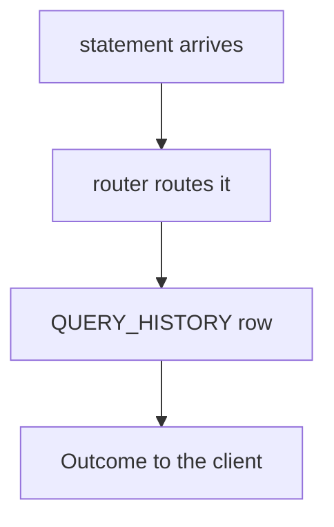
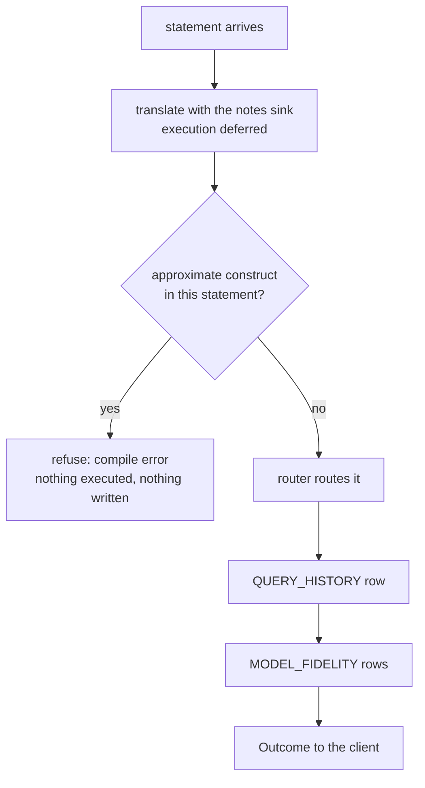

# snowtest 5.0.0 — Release Notes

**Release date:** 2026-11-18

Everything a statement passes through on its way in now has one owner:
`src/interceptor.ts`. That is not a new feature by itself — the history row and
the timing it writes were always there — but it is the seam the fidelity work
hangs from, and it is why this release is a major: the emulated account gains an
object it did not have, and the server gains a mode in which it will refuse
statements it used to accept.

## What changed

### The interceptor, in three modes

`--fidelity <off|report|strict>` (or `SNOWTEST_FIDELITY`) decides what happens
around every incoming statement. The default is `report`.

#### `off` — nothing but the router



The history row still gets written: it is account bookkeeping that predates this
release and tests depend on it. What `off` removes is the fidelity pass —
no notes collected, no ledger written, and 4.x behaviour end to end.

#### `report` — say it, never stop it


The statement runs either way. The verdict is a spending hint. `approximate`
means the answer came from a substitution that does not mean *exactly* what
Snowflake means: variant paths (`json_extract`), `FLATTEN` (`json_each`) and
`CONVERT_TIMEZONE` (`timezone()`), and only a real Snowflake run can confirm it.

Faithful translations are deliberately not reported. `IFF` becomes `CASE`,
`NVL2`, `ZEROIFNULL`, `NULLIFZERO`, `DIV0` and `DECODE` become their exact
equivalents, and `QUALIFY` is answered by DuckDB itself rather than rewritten.
Warning about those would be noise, and noise is how a reader learns to skip
the warnings that matter.

#### `strict` — refuse before anything executes



Strict costs a second translation pass on every statement, because the decision
has to be made before the first one runs. That is the price of refusing early
instead of rolling back late. The refusal names the construct and points at
`report`, so it reads as a setting doing its job rather than as broken SQL.

### The ledger

`SNOWFLAKE.ACCOUNT_USAGE.MODEL_FIDELITY` records, per dbt model, what ran and
what it leaned on. A statement with no `node_id` in its query comment is not a
model and is not recorded; the history row still covers it. Rows are append-only
and a reset empties them, the same way history is kept.

The attribution comes from the `node_id` dbt writes into its query comment, read
from the raw statement *before* comments are stripped. A model is
`verified` when every statement it sent needed nothing approximated, and
`approximate` otherwise, with the constructs listed.

```json
GET /_snowtest/models
{
  "fidelity": "report",
  "models": [
    { "nodeId": "model.shop.orders", "statements": 12, "constructs": ["CONVERT_TIMEZONE"], "verdict": "approximate" },
    { "nodeId": "model.shop.customers", "statements": 8, "constructs": [], "verdict": "verified" }
  ]
}
```

### The timings table says which queries leaned on a rewrite

`QUERY_HISTORY` gains a `fidelity` column, written with the row: `verified`,
`approximate: CONVERT_TIMEZONE`, or NULL when the statement named no dbt model or
the mode is `off`. The Query timings table on the landing page shows it as a chip,
with the constructs in the tooltip, and a rows dropdown between the chart and
the table narrows that list to statements a dbt model sent (`?fidelity=model`,
a plain form, so it works without the script). The table shows the latest 50
statements; clicking an hour in the chart shows every statement from that hour.

A volume written by 4.x keeps every timing row. The engine adds the column in
place at attach rather than recreating the table, so nothing is lost — but those
older rows read NULL, because the verdict was never recorded for a statement that
ran before this release. NULL is the honest value there; back-filling `verified`
would make the whole ledger untrustworthy. Clear the timings with the Clear Data
tab, `POST /_snowtest/queries/clear` or a reset if you want a table that starts
clean at 5.0.0.

### Changing it while it runs

The **Settings** page (its own tab in the site nav, after Self Test) leads with the
control: a dropdown, an Apply button, and the mode in force with the reason it is
in force. Below it, what each mode does, because "strict" is not
self-explanatory until a dbt run stops on it.

Applying takes effect on the next statement: the interceptor reads the mode per
statement rather than at boot. `POST /_snowtest/fidelity` with
`{"value": "off" | "report" | "strict"}` is the same thing from curl.

The choice is saved in `settings.json` beside the databases, so it survives a
restart, and a reset leaves it alone. `--fidelity` or `SNOWTEST_FIDELITY` still
wins: while either is set the page shows the mode as pinned and refuses to
override it, rather than saving a value that could never take effect. A server
with no data directory holds the choice in memory and says so.

### A refusal stops looking like your bug

A construct snowtest cannot emulate used to arrive as a Snowflake compile error.
It still uses Snowflake's compile-error shape — clients branch on that — but the
history row now records it as `SNOWTEST_LIMIT` rather than a code that accuses
the client's SQL, and the message says "not supported on snowtest".

## What changes for existing setups

- `SNOWFLAKE.ACCOUNT_USAGE.MODEL_FIDELITY` is a new object. Anything that
  inspects the account's contents will see it, even under the default `report`.
- `QUERY_HISTORY` gains a `fidelity` column. Existing rows survive and read NULL;
  no timing data is dropped by the upgrade.
- `--fidelity` and `SNOWTEST_FIDELITY` are new; `report` is the default and
  changes no statement's result. An unrecognised value is a startup error, not a
  silent fallback.
- `strict` is opt-in and is the only mode that can refuse a statement. It is
  never the default.
- The emulated Snowflake version (`SERVER_VERSION`, 8.42.0) is unchanged — that
  number describes the server we imitate, not this release.
