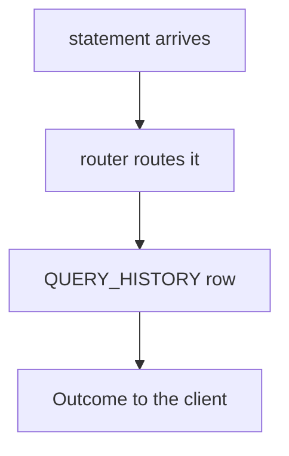
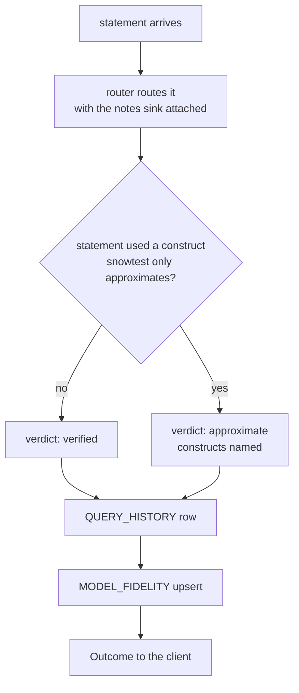
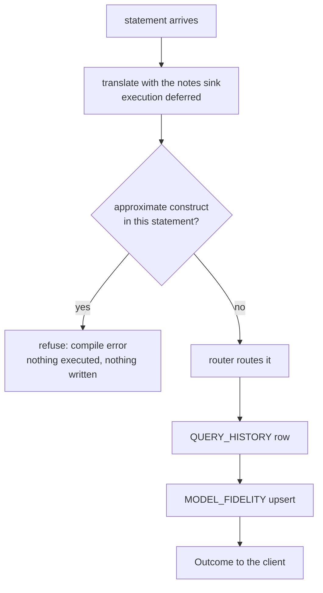

# snowtest 5.0.0 — Release Notes

**Release date:** (unreleased — draft on `feat/5.0.0-model-fidelity`)

> **This note ships when its claims are true.** It is being written while the
> branch is built, because the mode flows below are the contract the code has to
> meet. Do not merge 5.0.0 with any part of this document still describing
> something the server does not do.

Everything a statement passes through on its way in now has one owner:
`src/interceptor.ts`. That is not a new feature by itself — the history row and
the timing it writes were always there — but it is the seam the fidelity work
hangs from, and it is why this release is a major: the emulated account gains an
object it did not have, and the server gains a mode in which it will refuse
statements it used to accept.

## What changed

### The interceptor, in three modes

`--fidelity <off|report|strict>` (or `SNOWTEST_FIDELITY`) decides what happens
around every incoming statement. The default is `report`;

#### `off` — nothing but the router

The history row still gets written: it is account bookkeeping that predates this
release and tests depend on it. What `off` removes is the fidelity pass —
no notes collected, no ledger written, and 4.x behaviour end to end.

#### `report` — say it, never stop it

The statement runs either way. The verdict is a spending hint: `approximate`
means the answer was produced by a substitution (`IFF` as `CASE`, `QUALIFY` as a
subquery, `DIV0`, variant paths) and only a real Snowflake run can confirm it.

#### `strict` — refuse before anything executes

Strict costs a second translation pass on every statement, because the decision
has to be made before the first one runs. That is the price of refusing early
instead of rolling back late.

### A refusal stops looking like your bug

A construct snowtest cannot emulate used to arrive as a Snowflake compile error.
It now arrives marked as a limit of the stub, so "my SQL is wrong" and "this
stub cannot answer that" stop looking identical.

## What changes for existing setups

- `SNOWFLAKE.ACCOUNT_USAGE.MODEL_FIDELITY` is a new object. Anything that
  inspects the account's contents will see it, even under the default `report`.
- `--fidelity` and `SNOWTEST_FIDELITY` are new; `report` is the default and
  changes no statement's result.
- `strict` is opt-in and is the only mode that can refuse a statement. It is
  never the default.
- The emulated Snowflake version (`SERVER_VERSION`, 8.42.0) is unchanged — that
  number describes the server we imitate, not this release.
